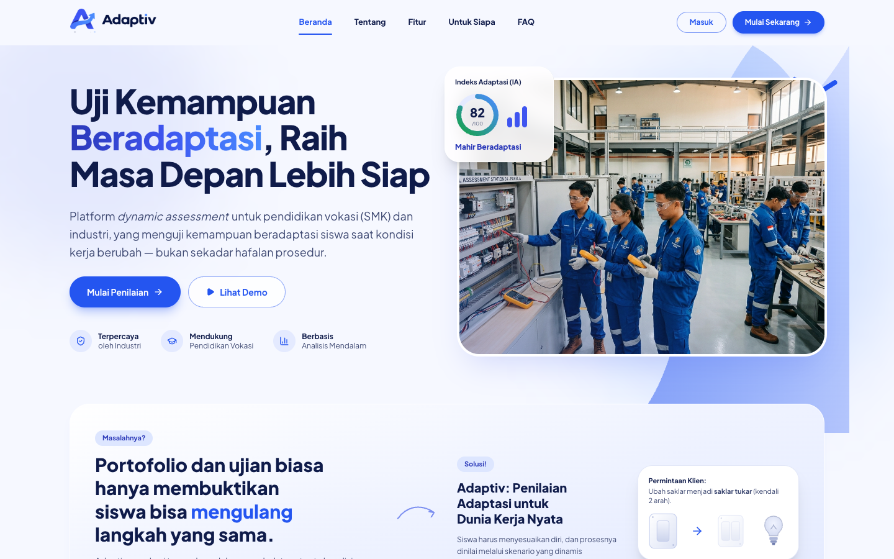
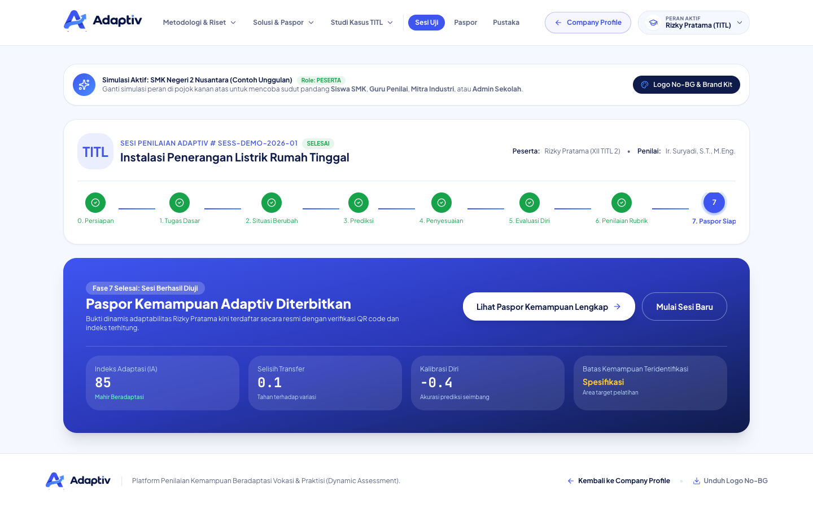
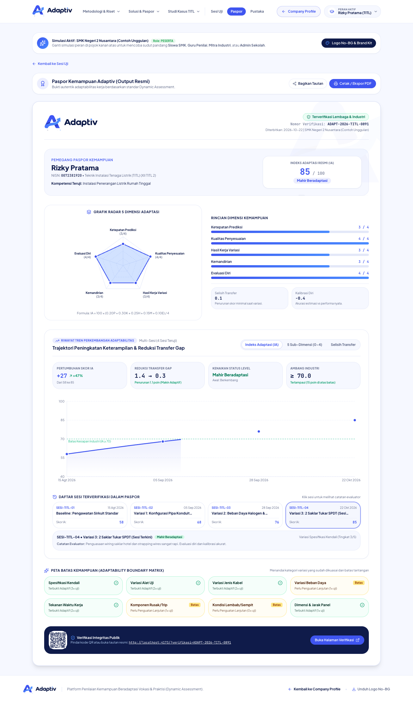
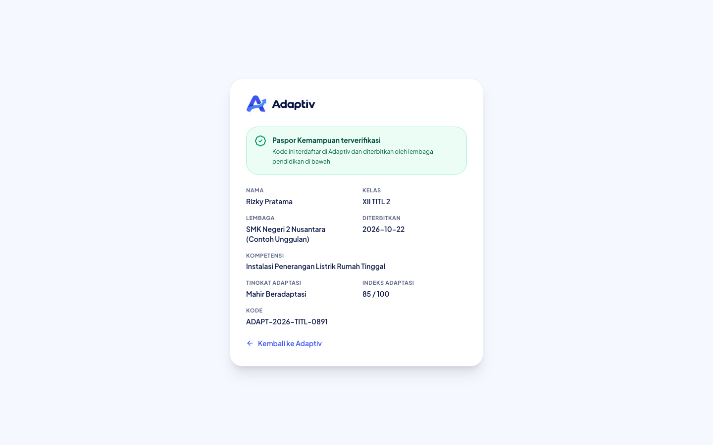
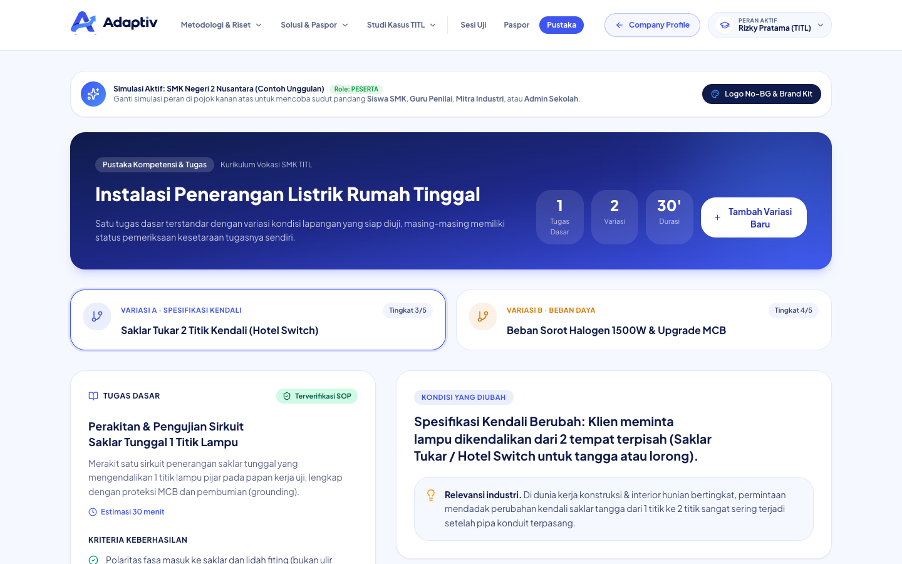
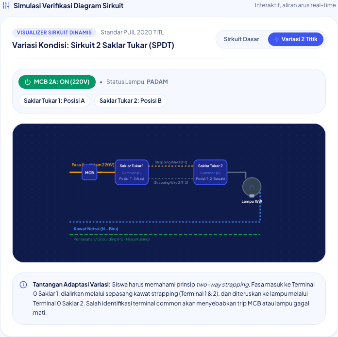
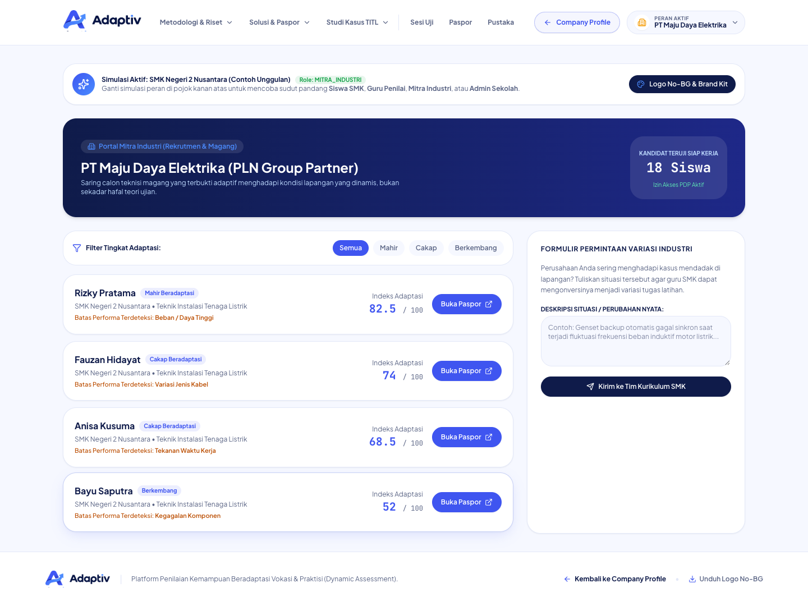
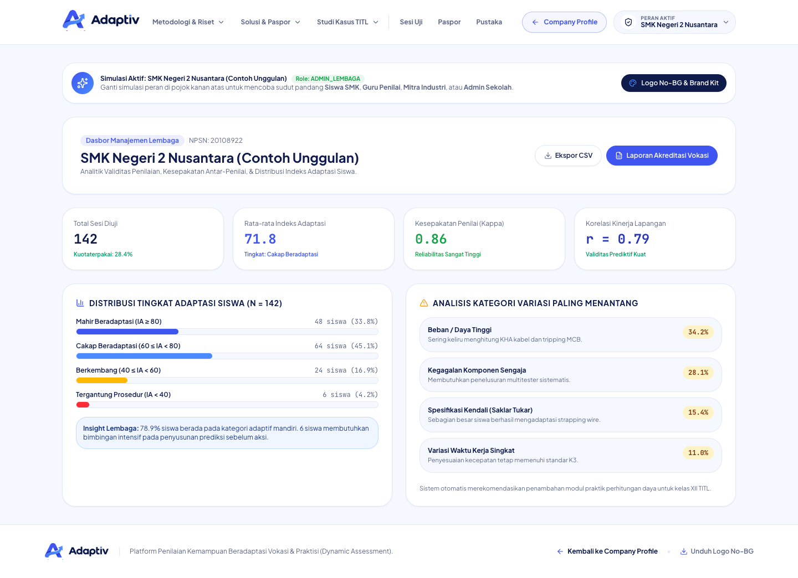

<p align="center">
  Platform <em>dynamic assessment</em> untuk pendidikan vokasi (SMK) dan industri:
  menguji apakah siswa benar-benar bisa menyesuaikan keterampilan saat kondisi kerja berubah,
  bukan sekadar mengulang prosedur hafalan.
</p>

<p align="center">
  
  
  
  
</p>



## Masalah yang diselesaikan

Portofolio, sertifikat, dan ujian tugas bisa menunjukkan hasil bagus, tetapi tidak membuktikan siswa mampu menghadapi variasi pekerjaan nyata. Adaptiv menilai **proses adaptasi**: siswa memprediksi, menyesuaikan diri saat kondisi tugas diubah, lalu mengevaluasi dirinya sendiri. Hasilnya dirangkum dalam **Indeks Adaptasi (IA)** dan **Paspor Kemampuan** yang bisa diverifikasi industri.

## Fitur utama

### Sesi uji 7 fase
Alur penilaian dari persiapan, tugas dasar, situasi berubah, prediksi, penyesuaian, evaluasi diri, sampai penilaian rubrik dan penerbitan paspor.



### Paspor Kemampuan
Radar 5 dimensi (prediksi, penyesuaian, hasil, kemandirian, evaluasi), tren Indeks Adaptasi antar sesi, peta batas kemampuan, serta QR code untuk verifikasi publik. Bisa dibagikan lewat tautan atau dicetak ke PDF.



### Verifikasi publik
Siapa pun yang memindai QR atau membuka tautan paspor melihat keabsahan dan ringkasan hasilnya, tanpa perlu akun.

<p align="center"></p>

### Pustaka tugas dan visualizer sirkuit
Tugas dasar standar beserta variasinya, daftar kriteria, petunjuk bertingkat yang mengurangi skor kemandirian, dan simulasi diagram sirkuit interaktif.



<p align="center"></p>

### Portal mitra industri
Industri menyaring kandidat menurut tingkat adaptasi, membuka paspor mereka, dan mengirim permintaan variasi kasus lapangan ke tim kurikulum SMK.



### Dasbor lembaga
Distribusi tingkat adaptasi siswa, kesepakatan antar-penilai (Kappa), korelasi dengan kinerja lapangan, dan kategori variasi paling menantang. Data bisa diekspor ke CSV.



### Simulasi lima peran
Ganti peran langsung dari navbar untuk melihat sudut pandang **Siswa**, **Guru Penilai**, **Mitra Industri**, **Admin Lembaga**, dan **Super Admin**.

## Kualitas dan aksesibilitas

- **Aksesibilitas:** 0 pelanggaran pada audit axe-core (WCAG 2.1 AA) di landing, sesi uji, paspor, pustaka, portal industri, dasbor lembaga, dan halaman verifikasi. Label form terhubung ke field, kontras warna memenuhi 4,5:1, modal memakai `role="dialog"`, dan menu peran bisa dipakai lewat keyboard maupun sentuh.
- **Responsif:** tidak ada overflow horizontal di lebar 390, 768, dan 1440 px. Form penilaian menumpuk rapi di ponsel.
- **Validasi:** prediksi dan refleksi tidak bisa dikunci dalam keadaan kosong, dan isian spasi saja ditolak di form variasi tugas.
- **Ukuran teks:** teks isi minimal 12 px, label huruf kapital minimal 11 px.

## Menjalankan secara lokal

Prasyarat: Node.js 20 atau lebih baru.

```bash
npm install
npm run dev        # http://localhost:3000
```

| Perintah | Fungsi |
|---|---|
| `npm run dev` | server pengembangan |
| `npm run typecheck` | pemeriksaan tipe (`tsc --noEmit`) |
| `npm run build` | build produksi ke `dist/` |
| `npm run preview` | pratinjau hasil build |

Aplikasi ini SPA statis tanpa backend. Seluruh data contoh ada di [src/data/seedData.ts](src/data/seedData.ts) dan tidak ada variabel lingkungan yang wajib diisi.

## Deploy ke Vercel

Konfigurasi sudah disiapkan di [vercel.json](vercel.json) (preset Vite, header keamanan dasar, cache aset). Impor repo di Vercel lalu deploy tanpa pengaturan tambahan. Verifikasi paspor memakai query string (`?verifikasi=KODE`), jadi tidak perlu aturan rewrite.

## Struktur proyek

```
src/
  components/   komponen per fitur: admin, assessment, brand, circuit,
                company, industry, layout, library, passport
  data/         data contoh (seed)
  types/        tipe TypeScript domain
  utils/        logika skor, paspor, unduhan
public/         logo, ikon, dan foto
docs/           dokumentasi, laporan audit, dan screenshot
```

## Catatan

Data siswa, sekolah, dan perusahaan di aplikasi ini adalah contoh fiktif untuk demonstrasi.

## Author & License

Created by Vassel Goleyu. Copyright (c) 2026 Vassel Goleyu. All rights reserved. Lihat [LICENSE](LICENSE).
